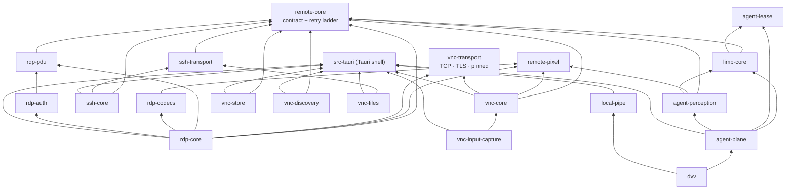

# OraxDesk architecture and protocol reference

This document is the detailed technical reference for OraxDesk: the full protocol
feature list, the security model, the crate layout, and the build and packaging
notes. It was the project README through v0.22.0 and is preserved here because
the detail is valuable to contributors and to anyone evaluating the client's
protocol coverage. The README now leads with what the tool is for; this file is
where the engineering detail lives.

---

# The crates, and how they depend on each other

The workspace is 27 crates plus the Tauri shell and the webview, and the
layering is the design: one protocol-neutral contract at the bottom, protocol
cores that know nothing about the app, transports underneath them, runtimes
that join the cores to a live session, and a shell that is the only place
allowed to know about all of it.

## Rules the layout enforces

* **No protocol core names Tauri, ever.** Cores outlive the frontend, and the
  agent plane is written against the session registry so it stays reachable
  from a headless binary.
* **Pure wire and codec crates have no I/O and no session state.**
  `rdp-pdu`, `rdp-codecs` and `rdp-auth` are functions over slices; two of them
  carry fuzz targets (`crates/*/fuzz`) because they parse bytes from strangers.
* **`unsafe` is an OS boundary, not a parser.** `boundary-platform` (Win32
  and macOS capture and input), `vnc-input-capture`, and `local-pipe` (the
  Windows named pipe) are the crates that call into the platform. `dvv`
  resets `SIGPIPE` to the default disposition once, at startup, before any
  other thread exists, and only for the one-shot CLI. Protocol, codec, and
  store crates declare `#![forbid(unsafe_code)]`. `vnc-files` has no `unsafe`
  block; the word appears there only in messages that reject a path.
* **A parse of untrusted bytes returns a `Result`.** A panic in a codec is a
  bug. The shell turns a session error into a sentence the window can show;
  it does not unwrap a protocol failure to keep going.
* **Whole framebuffers never cross a channel as one value.** Decoded pixels
  travel as dirty rects (`remote_core::RectPayload`), which is also why the
  agent mirror can see exactly the same rectangles the renderer does.

## The crates

| Layer | Crate | Responsibility |
| --- | --- | --- |
| Contract | `remote-core` | The protocol-neutral session contract: `SessionEvent`/`ClientCommand`, `RectPayload`, `ConnectOptions`, credentials, the retry ladder (`reconnect`), `NamedKey`, and the classical Arabic X11 keysym table the VNC and RDP input paths share. Every protocol crate depends on it. |
| Contract | `remote-pixel` | Pixel format conversion shared by every decoder: channel order, endianness, row padding — one implementation instead of one per protocol. |
| Protocol | `vnc-core` | UI-agnostic RFB core: handshake 3.3–3.8, security (VNC auth, VeNCrypt, RA2, Apple DH), every common encoding, dirty-rect assembly, keysym input. |
| Protocol | `rdp-core` | The RDP session: connection sequence (X.224, MCS, licensing, capability exchange), channel map, run loop, EGFX, input lowering, the fast-path encoder. |
| Protocol | `rdp-pdu` | MS-RDPBCGR wire formats — parsing and serialising, no I/O and no session state. Fuzzed. |
| Protocol | `rdp-codecs` | Bitmap decoders as pure functions over caller-owned slices. Fuzzed. |
| Protocol | `rdp-auth` | CredSSP, SPNEGO and NTLMv2 as pure state machines. Fuzzed. |
| Protocol | `ssh-core` | A remote shell that behaves: PTY and terminal state, a supervisor that reconnects, multiplexer attach (tmux/screen/zellij), tunnels, SFTP session. |
| Protocol | `ssh-transport` | The SSH carrier: dial, host-key verification against pinned TOFU entries, agent authentication, keepalive, tunnelling, and an injectable dialer so a session can ride the proxy stream that VNC and RDP already use. |
| Transport | `vnc-transport` | Byte streams: TCP with a staggered dual-stack race (Happy Eyeballs), TLS for VeNCrypt/RA2, TLS pinning, and a SOCKS5 `CONNECT` client as a `StreamConnector` (the proxy resolves the name, never this machine). |
| Transport | `local-pipe` | The Windows named pipe and its Unix socket counterpart for the agent plane, created so only its creator can open it. |
| Storage | `vnc-store` | SQLite: host profiles, groups, tags, history, settings, thumbnails. |
| Discovery | `vnc-discovery` | mDNS/DNS-SD browsing, a polite active subnet scan with RFB banner fingerprinting, name resolution over mDNS/LLMNR/NetBIOS/MS-RPC, Wake on LAN. |
| Files | `vnc-files` | File transfer over an SFTP sidecar, shared by the Files panel and the agent's `files.*` verbs. |
| Input | `vnc-input-capture` | Native OS-level keyboard capture for shortcut pass-through (Tier 2). |
| Cloud | `orax-registry` | Client for the device registry and signal-code API (the Cloudflare Worker + D1 in `cloudflare/`). |
| Agent | `limb-core` | The contract a limb implements: intents an agent may issue, observations a limb emits, the capabilities that gate both, and the identity a limb keeps across a reconnect. |
| Agent | `agent-lease` | Control arbitration: who is driving a limb right now, how the wheel moves, and what happens when somebody else wants it. |
| Agent | `agent-perception` | What an agent may see: a server-side framebuffer mirror, damage tracking, and the crop/downscale/encode path that turns pixels into an observation. |
| Agent | `agent-plane` | The runtime that joins those three to live sessions: limb registry, intent lowering onto `ClientCommand`, lease enforcement, observation path, counts. |
| Agent | `dvv` | What an agent actually connects to: an MCP server over stdio and a CLI over the same `dvvp.v1` socket; shipped as the app's sidecar. |
| Support | `boundary-session` | The OraxDesk Support app's session core: wire, session, DNS, tools, unattended mode. |
| Support | `boundary-codes` | The signal-code pairs that pair two people (with the optional code-server feature). |
| Support | `boundary-driver` | Drives an established support session: input, buttons, events. |
| Support | `boundary-platform` | OS-level screen capture and input injection, plus system probes; the crate with the most `unsafe`. |
| Support | `boundary-provision` | Autostart, network detection, the Cloudflare tunnel, process management. |
| Support | `boundary-app` | The Support app binary that composes the five above. |
| Shell | `src-tauri` | The Tauri shell: session commands, window rules, event emitters, the ACL manifest, and the agent socket's shell glue (consent gates included). |
| Shell | `ui/` | The React + WebGL2 webview (not a crate; not published). |

## Principal dependency edges



`boundary-*` stands apart by design: it is the Support app family, composed by
`boundary-app`, and it shares only `orax-registry` and `remote-core` with the
main application. `rdp-core` reaches `vnc-transport` for TLS and nothing else,
which is the one edge worth knowing about before moving TLS code.

## What a bad virtual-channel byte is allowed to do

RDP channels are not equal, and the difference is tested rather than implied.

* A malformed **clipboard** PDU disables the clipboard. The session continues,
  and a bitmap that arrives afterwards is still drawn
  (`an_unjoined_channel_ends_the_session_and_a_malformed_one_only_isolates_its_channel`
  in `rdp-core`).
* A malformed **graphics** channel ends the session. That includes an eGFX
  message that fails after ZGFX decompression
  (`a_malformed_egfx_message_after_decompression_is_reported_and_names_zgfx`).
  Continuing would desynchronise the picture: the next rectangle would land
  on a stream the client no longer understands.
* A channel id the client never joined ends the session. The message channel
  and the user channel have no handler and are skipped, with a reason.

---

# OraxDesk

A fast, native VNC viewer for Windows, macOS, and Linux, built with Rust and
Tauri 2.

The RFB implementation is pure Rust with no `unsafe` and no C dependencies. The
interface is React with a WebGL2 renderer. Decoded pixels reach the screen as
binary dirty-rect messages rather than serialised frames, so a full framebuffer
never crosses the IPC boundary.

[](#license)

> **Status: pre-1.0, under active development.** The protocol core is well
> covered by tests and interoperability work is ongoing. Stored data and the
> IPC contract may change between minor versions. See
> [CHANGELOG.md](CHANGELOG.md).

## Installing

Prebuilt binaries for macOS, Windows and Linux are on the
[latest release](https://github.com/Mohammedorax/OraxDesk/releases/latest).

The **macOS** build is signed and notarized, so it opens normally. The
**Windows** installer is unsigned, so SmartScreen shows "Windows protected your
PC"; continue with **More info** then **Run anyway**, or verify the published
checksum first, or build from source. **Linux** packages are unsigned.

Full details, including checksum verification and the permissions the app asks
for, are in [docs/INSTALL.md](docs/INSTALL.md).

## Features

### Protocol

- **RFB 3.3 through 3.8**, with version negotiation.
- **Encodings**: Raw, CopyRect, RRE, Hextile, Zlib, ZRLE, Tight, and Open H.264.
- **Pseudo-encodings**: Cursor, Cursor With Alpha, X Cursor, VMware Cursor,
  Desktop Size, Extended Desktop Size, Desktop Name, Extended Clipboard, Fence,
  Continuous Updates, LastRect, Extended Mouse Buttons, and the QEMU key, LED
  state, and pointer motion extensions.
- **Adaptive quality**: Auto, High, Medium, Low, and Black and White presets.
  Auto tunes JPEG quality and subsampling against measured throughput.
- **Remote resize** through Extended Desktop Size, so the server follows your
  window.

H.264 framing and decoder-context bookkeeping live in Rust; the video decode
itself runs in the webview through WebCodecs, which gets hardware acceleration
via VideoToolbox, D3D11, or VAAPI.

### Authentication and transport

- **None**, **VncAuth**, **VeNCrypt** (including the X509 subtypes),
  **RealVNC RSA-AES (RA2)**, **Apple Diffie-Hellman** for macOS Screen Sharing,
  **MS-Logon**, and Tight security negotiation.
- **TLS through rustls** with trust-on-first-use certificate pinning. A changed
  certificate is surfaced rather than silently accepted.
- **SSH tunnelling** for the RFB connection, per host profile. The session runs
  over a `direct-tcpip` channel of an SSH login, which reaches servers bound to
  the remote machine's own loopback and encrypts the session even when the VNC
  server itself offers nothing. Authentication is a saved passphrase, your
  ssh-agent, or a key file. Host keys are trust-on-first-use, pinned in the same
  store the file-transfer sidecar uses, so trusting a machine once covers both.
  No local forwarded port is opened: the channel is the session's byte stream,
  so nothing else on your machine can reach it.
- **SOCKS5** (Preferences → Network, off until it is switched on). VNC, RDP
  and SSH sessions, file transfer and terminals dial through it. The proxy
  resolves the name. Only the no-authentication method is offered. A
  switched-on proxy with an unusable address refuses the connect instead of
  dialling directly. A per-host SSH tunnel still carries the session; the
  proxy is how that tunnel reaches its gateway.

VncAuth is DES based and truncates passwords to 8 characters. That is a flaw in
the protocol, not this client. Prefer VeNCrypt or RA2 where the server offers
them.

### Credentials

- **OS keychain** storage: Keychain Services on macOS, Credential Manager on
  Windows, Secret Service on Linux.
- **Encrypted-file fallback** for headless or locked-keyring environments, using
  XChaCha20-Poly1305 under an Argon2id derived key, with the KDF parameters
  bound as additional authenticated data so they cannot be downgraded.
- Secrets never touch the profile database. A test asserts that saving a host
  writes nothing sensitive into the SQLite file or its write-ahead log.

### Discovery

- **mDNS** browsing for `_rfb._tcp` and `_ard._tcp`.
- **Subnet scan** with RFB banner fingerprinting, rate limited to stay polite on
  shared networks.
- **Name resolution** over mDNS, LLMNR, NetBIOS, and MS-RPC, so hosts show up
  with real names instead of bare addresses.
- **Wake-on-LAN**, including during reconnect attempts.

Every discovery response is parsed as hostile input. Any host on the network can
answer these queries and the result is rendered in the interface.

### Session and interface

- **Host library** on SQLite with friendly names, groups, tags, live
  thumbnails, connection history, and double-click connect. Computers are
  selected the way files are, with Cmd/Ctrl-click, Shift for a run, or a
  marquee sweep, and a selection can be dragged onto a group or a tag in the
  sidebar to file the whole lot at once.
- **QuickConnect** address bar: type `host`, `host:1`, `host:5901`, `host::5901`,
  `[::1]:5901`, or a `vnc://` link and press Enter. Nothing has to be saved
  first, and typing the address of a host you did save connects through that
  profile so its settings and password still apply.
- **Command palette** for keyboard-driven navigation.
- **Windows or tabs**: each session opens in a window of its own, or, with
  "Show sessions as tabs in one window" in Preferences, as a tab in the library
  window that you switch between the way you switch browser tabs.
- **Display modes**: fit, aspect-fit, 1:1, and custom zoom, all HiDPI correct.
- **Input**: full mouse and keyboard, scancode mode via the QEMU extension,
  and three-tier shortcut pass-through so host and guest shortcuts coexist.
  Global capture uses platform APIs and needs Accessibility permission on macOS.
- **Extended Clipboard** with UTF-8, RTF, and HTML, falling back to Latin-1 for
  older servers.
- **File transfer** over SFTP with a dual-pane browser and drag and drop.
  Remote filenames are validated before they are used to build local paths.
- **Automatic reconnect** with fast first retry, then backoff with jitter, while
  preserving session state.
- **System tray** and global shortcuts.

### Not yet implemented

Being explicit so nobody files an issue against a feature that was never there:

- **Signed Windows and Linux installers.** Windows needs an Authenticode
  certificate, which is a paid commercial product, so SmartScreen warns on
  first run. See [docs/INSTALL.md](docs/INSTALL.md). macOS release builds
  *are* signed and notarized in CI.

Note that `scripts/package-macos.sh` builds for the host architecture only. The
release workflow builds a universal macOS binary covering both.

## Architecture

```
crates/
  remote-core/         Protocol agnostic session contract: options, events, commands, state
  remote-pixel/        Pixel format conversion, no dependencies at all
  vnc-core/            RFB protocol, encodings, security, input, clipboard, session, reconnect
  vnc-transport/       TCP and TLS (rustls) with trust-on-first-use pinning
  vnc-discovery/       mDNS, subnet scan, banner fingerprint, name resolution, Wake-on-LAN
  vnc-store/           SQLite host profiles, keychain credentials, thumbnails
  vnc-files/           SFTP file transfer and SSH tunnelling (russh)
  vnc-input-capture/   Platform global input capture
src-tauri/             Tauri 2 shell: commands, framebuffer channel, windows, menus, tray
ui/                    React, TypeScript, Tailwind v4, WebGL2 renderer
```

Two invariants hold the design together:

**`vnc-core` does not depend on Tauri.** The protocol layer is interface
agnostic, so the frontend can be replaced without touching protocol code. It
also means `cargo test -p vnc-core` runs without a system webview, which makes
it the fastest place to work.

**Whole framebuffers never cross IPC.** Decoded pixels travel as binary
dirty-rect messages over a Tauri channel and are uploaded into a single WebGL2
texture.

`remote-core` holds everything in the session contract that is not RFB, so a
second protocol can implement `remote_core::ProtocolDriver` and reach the same
shell. `vnc-core` re-exports it, so `vnc_core::Rect` and the rest still resolve
where they always did, and the wire contract with the webview is unchanged.

Every crate that parses bytes from a remote peer declares
`#![forbid(unsafe_code)]`. `unsafe` is confined to the platform boundary
(`boundary-platform`, `vnc-input-capture`, `local-pipe`) and to one `SIGPIPE`
reset in `dvv`. See the layout rules at the top of this file.

Source comments cite an internal specification as `PRD/NN §S`. Those documents
are not part of this repository. The citations record why a decision was made,
so treat them as provenance rather than links. Public technical notes live in
`docs/`.

## Building

Prerequisites: **Rust 1.82 or newer**, **Node 22 or newer**, and the
[Tauri 2 system dependencies](https://v2.tauri.app/start/prerequisites/) for
your platform.

```sh
npm install --prefix ui
cargo install tauri-cli --version "^2"   # if you do not have it

cargo tauri dev      # development, with hot reload
cargo tauri build    # production bundle
```

### Workspace checks

These are what CI runs:

```sh
cargo fmt --all -- --check
cargo clippy -p remote-core -p remote-pixel -p vnc-core -p vnc-transport \
  -p vnc-discovery -p vnc-store -p vnc-files -p vnc-input-capture -- -D warnings
cargo test -p remote-core -p remote-pixel -p vnc-core -p vnc-transport \
  -p vnc-discovery -p vnc-store -p vnc-files -p vnc-input-capture
(cd ui && npx tsc --noEmit)
```

Tests that touch the real OS keychain or a live VNC server are marked
`#[ignore]`. Run them deliberately with `cargo test -- --ignored`.

The debug build under `target/` is the largest thing a development checkout
produces: the incremental cache and a `.pdb` per test binary reach several
gigabytes within a day, and a full disk fails a link with an error that does
not mention disk space. `./scripts/clean.ps1` (Windows) removes those two and
keeps every reusable crate artifact; `./scripts/clean.ps1 -All` is the
`cargo clean` answer when nothing can be reused anyway.

### Packaging on macOS

```sh
./scripts/package-macos.sh
```

This builds the `.app`, signs it, notarizes and staples both the app and the
disk image when notarization credentials are available, and produces a DMG.

Two notes on why it exists rather than just calling `cargo tauri build`:

Tauri's DMG bundler shells out to `create-dmg`, which drives Finder over
AppleScript. In any non-interactive session (SSH, CI without a GUI session, or
when Automation permission has not been granted) that fails with
`AppleEvent timed out (-1712)`. This script uses `hdiutil`, which needs no
Finder. The result is cosmetically plainer and functionally identical.

An ad-hoc signed macOS build also loses its keychain and permission grants on
every rebuild, because the code identity is a hash of the binary. Clicking
"Always Allow" appears to do nothing. See
[docs/MACOS_SIGNING.md](docs/MACOS_SIGNING.md) for why, and for the setup that
fixes it.

## Contributing

Bug reports, interoperability findings, and pull requests are all welcome. If
you have hit a server this client mishandles, an issue naming the server and its
version is genuinely useful on its own.

Start with [CONTRIBUTING.md](CONTRIBUTING.md).

For security issues, do not open a public issue. See
[SECURITY.md](SECURITY.md).

## License

Licensed under either of

- Apache License, Version 2.0 ([LICENSE-APACHE](LICENSE-APACHE) or
  <https://www.apache.org/licenses/LICENSE-2.0>)
- MIT License ([LICENSE-MIT](LICENSE-MIT) or <https://opensource.org/licenses/MIT>)

at your option.

Unless you explicitly state otherwise, any contribution intentionally submitted
for inclusion in this work by you, as defined in the Apache-2.0 license, shall
be dual licensed as above, without any additional terms or conditions.
